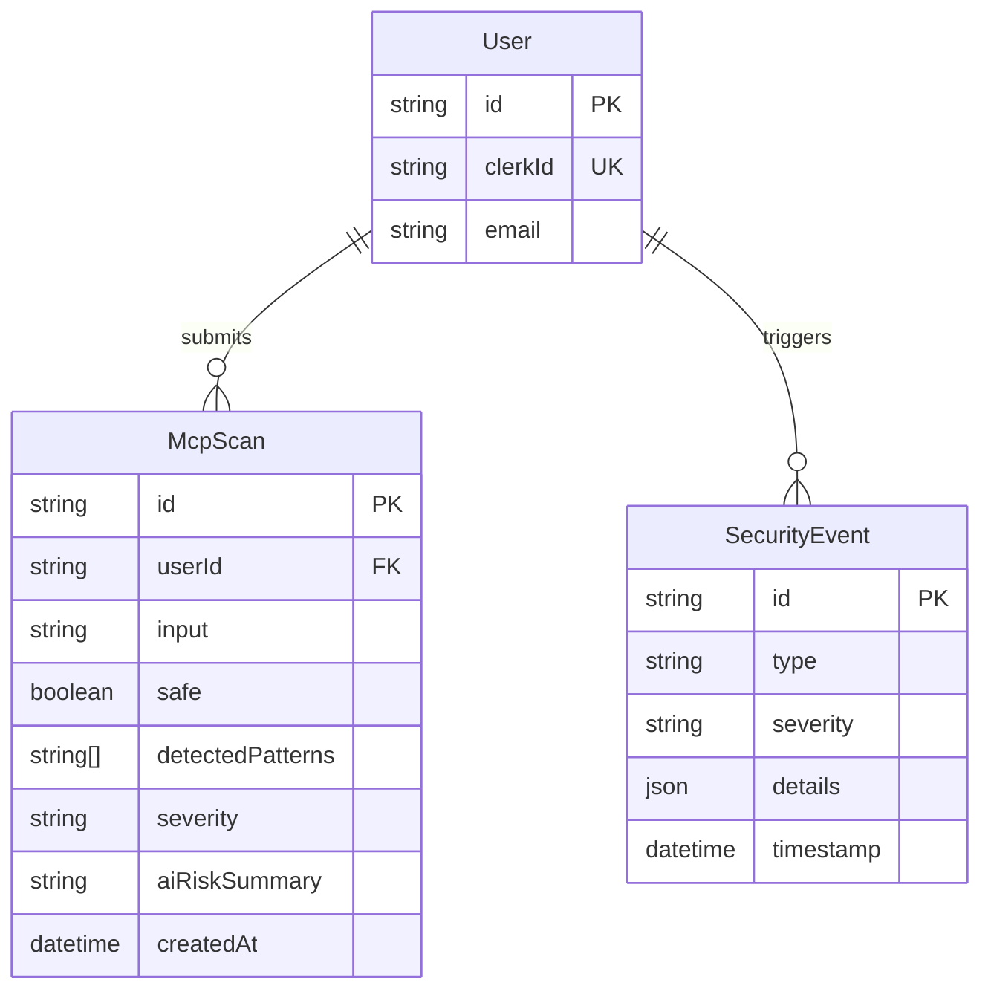

<div align="center">

# McpGuard Lite

**MCP tools/list risk scanner for AI agents**

[](https://nextjs.org)
[](https://www.typescriptlang.org)
[](https://clerk.com)
[](https://www.prisma.io)
[](https://neon.tech)
[](https://tailwindcss.com)
[](https://vercel.com)

**[Live Demo →](https://mcpguard-lite.vercel.app)**

</div>

---

## What It Does

McpGuard Lite analyzes a raw MCP `tools/list` JSON response and produces an instant risk report: which capability categories are present, which controls are missing, and what the overall severity is. Paste your server's tool manifest, get a structured security analysis in seconds.

---

## Scan Pipeline

```mermaid
flowchart LR
    A[MCP Server] -->|tools/list JSON| B[/dashboard/scans]
    B --> C[tools-list-report.ts\nAnalyzer]
    C --> D{Risk Detection}
    D -->|Command Execution| E[🔴 High Risk]
    D -->|Filesystem Access| E
    D -->|Network Access| F[🟡 Medium Risk]
    D -->|Secret Access| E
    D -->|Database Access| E
    D -->|Approval Bypass| E
    D -->|Read-only Ops| G[🟢 Low Risk]
    C --> H[Missing Controls Check]
    H -->|No human approval| I[⚠️ Gap]
    H -->|No audit logging| I
    H -->|No filesystem sandbox| I
    H -->|No network allowlist| I
    C --> J[(Neon Postgres\nvia Prisma)]
    C --> K[Scan Report\n+ Audit Trail]
```

---

## Capability Categories Detected

| Category | Description | Default Severity |
|---|---|---|
| `command_execution` | `shell.exec`, `bash`, `run_command` | High |
| `filesystem_access` | File read/write/delete operations | High |
| `network_access` | HTTP fetch, web browsing, DNS | Medium |
| `secret_access` | Credential reads, keychain, env vars | High |
| `database_access` | SQL queries, DB mutations | High |
| `approval_bypass` | Forced approvals, override flags | Critical |

---

## Missing Controls Detected

```
Controls Gap Analysis
├── ❌ Human approval gate not declared in tool descriptions
├── ❌ Audit logging not described for destructive operations
├── ❌ Filesystem operations lack sandbox scope declaration
└── ❌ Network operations lack egress allowlist declaration
```

---

## Data Model



---

## Tech Stack

<div align="center">

&nbsp;
&nbsp;
&nbsp;
&nbsp;


</div>

---

## Quick Start

```bash
cp .env.example .env.local
# Fill in Clerk keys, Neon connection strings, MCP secret
npm install
npm run db:generate && npm run db:push
npm run dev
```

Open [http://localhost:3000](http://localhost:3000).

## Environment Variables

| Variable | Description |
|---|---|
| `NEXT_PUBLIC_CLERK_PUBLISHABLE_KEY` | Clerk publishable key |
| `CLERK_SECRET_KEY` | Clerk secret key |
| `DATABASE_URL` | Neon pooled Postgres connection string |
| `DIRECT_URL` | Neon direct Postgres connection string |
| `MCP_API_SECRET` | Bearer token for `/api/mcp` |

---

## MCP API

McpGuard exposes its own MCP endpoint for programmatic scans:

```bash
# Analyze a tools/list payload
curl -X POST http://localhost:3000/api/mcp \
  -H "Authorization: Bearer $MCP_API_SECRET" \
  -H "Content-Type: application/json" \
  -d '{
    "tool": "analyze_tools_list",
    "userId": "user_xxx",
    "params": {
      "input": "{\"tools\":[{\"name\":\"shell.exec\",\"description\":\"Run shell commands\"}]}"
    }
  }'

# Get aggregate security stats
curl -X POST http://localhost:3000/api/mcp \
  -H "Authorization: Bearer $MCP_API_SECRET" \
  -H "Content-Type: application/json" \
  -d '{"tool":"get_stats","userId":"user_xxx"}'
```

---

## Project Structure

```
src/
  app/
    dashboard/          # Overview, scan history, security events
    dashboard/scans/    # Paste & analyze tools/list
    (auth)/             # Clerk sign-in / sign-up
    api/mcp/            # MCP REST endpoint
    api/scan/           # Internal analysis API
    api/scans/          # Scan history API
  lib/
    tools-list-report.ts   # Core deterministic analyzer
    mcp-scan-report.ts     # API/persistence adapter
    analytics.ts           # Security event tracking
    db.ts                  # Prisma singleton
prisma/
  schema.prisma            # User, McpScan, SecurityEvent
```

---

## Development Scripts

```bash
npm run dev           # Start dev server
npm run build         # Production build
npm run typecheck     # TypeScript check
npm run lint          # ESLint
npm run db:generate   # Regenerate Prisma client
npm run db:push       # Push schema to DB
npm test              # Vitest unit tests
```
